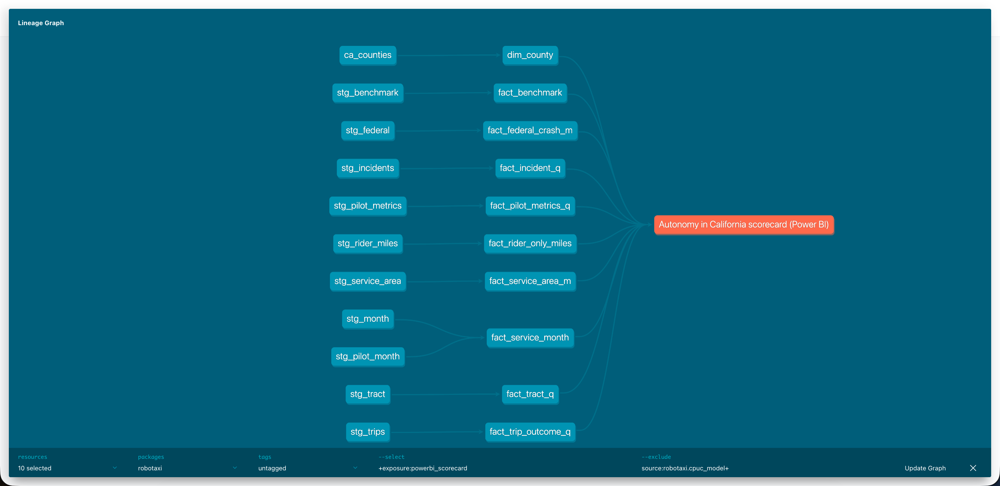

# Autonomy in California: from testing to paid rides

A data project on how robotaxis moved from permitted testing to paid, driverless service in California, built from public regulator and company data.

**Status:** data pipeline built with Python and dbt, tested, and checked against the original version. Power BI report in progress.

## The question
As robotaxi service scales in California, are safety and service quality keeping up? The scorecard follows one company (Waymo) from DMV permits through CPUC quarterly service reports to safety outcomes.

## Key findings (Dec 2024 to Jun 2026)
- Paid, driverless trips grew from **1.82 million** (2025 Q1) to **4.22 million** (2026 Q2), about **2.3x** in five quarters.
- Collisions per 100,000 trips stayed in a narrow band, **6.2 to 7.6**, and the exact 95% intervals overlap across quarters. Quarter-to-quarter moves are within what chance would produce.
- About **95%** of ride requests ended in a completed trip, and that held as volume more than doubled.
- Federal crash reports for California drop from **70 (May 2025) to 33 (June 2025)** while trips kept rising. A federal reporting rule changed on June 16, 2025, so this is a change in what is counted, not evidence of safer driving. The report compares rates per trip and marks the break.

## Data sources
| Source | What it provides |
|---|---|
| CPUC autonomous vehicle quarterly data reports (13 quarterly zips) | Trips, miles, incidents, complaints, service area by tract |
| California DMV autonomous vehicle permit holders | Permit stage by company |
| Waymo Safety Impact hub | Federal crash reports and human-benchmark comparisons |

## How the data is built
Python extracts and loads; dbt (Core + DuckDB) cleans, builds and tests.

```
raw zips (362 files, ~8 GB)
  -> 01 extract + manifest (lineage, file-type detection)
  -> 02 parse legacy pilot workbooks
  -> 03a land raw tables in DuckDB (as text)
  -> dbt: staging views -> 9 fact tables + county dimension -> 33 tests
  -> export to data/model/*.csv (~11 MB)  -> Power BI (star schema, DAX)
```



| Layer | Tool | What it does |
|---|---|---|
| Extract and parse | Python | Unzips the quarterly files and parses the pilot-era workbooks |
| Land | Python | Loads every raw file as text, tolerant of column-name changes |
| Clean | dbt staging views | Row-level cleaning, number and flag parsing |
| Model | dbt marts | 9 fact tables and a county dimension |
| Test | dbt | 33 tests: 30 pass, 3 warn, 0 fail |
| Export | Python | Writes the marts to `data/model/*.csv` |

Things worth knowing:
- **Schema drift** across quarters is handled by a column resolver, and a legacy "one row per requirement" layout is unpivoted so no quarter is dropped.
- **A disguised file:** one trips file with a `.csv` extension is actually an Excel workbook. The pipeline reads file signatures, not extensions.
- **Grain:** a row is a reported event, and collisions are counted from the Y flags, never from row counts. Every fact table also has a grain test.
- **Data quality:** 33 dbt tests, **30 PASS, 3 WARN, 0 FAIL**. WARN means a documented, explainable source gap: the two CPUC collision sources differ by a few records in 8 quarters, one deployment quarter has no incident file, and a few unfulfilled requests have no stated reason. Results are exported to `data/model/test_results.csv`.
- **Migration check:** the project started as a Python-only pipeline (43 checks: 33 pass, 10 warn). After the move to dbt, a parity check compared every table with the original in both directions, and all 9 fact tables match. The 10 old warnings correspond to the same 3 source gaps. See [docs/MIGRATION.md](docs/MIGRATION.md).
- **Redactions** are reported as redacted and never inferred.

## What is deliberately excluded
Assault and harassment complaint fields, street addresses and ZIP codes in the federal crash file, and any policy opinion. The project describes a measurement change; it does not judge it.

## Repository layout
```
pipeline/     extract, parse, land, export, parity check and run_all.py
dbt/          staging views, marts, macros, tests, exposure
data/
  reference/  DMV permits, county list
  model/      the model tables Power BI reads (committed on purpose)
  raw/        CPUC zips (not committed)
docs/         dbt lineage image, migration notes
powerbi/      report (in progress)
```

## Run it
```bash
python -m venv .venv && source .venv/bin/activate
pip install -r requirements.txt
python3.12 -m venv .venv-dbt
.venv-dbt/bin/pip install "dbt-core==1.12.7" "dbt-duckdb==1.11.1"
python pipeline/run_all.py                  # dbt engine (default)
python pipeline/run_all.py --engine both    # original Python version + dbt + parity check
```
Requires the DuckDB command-line tool and the raw CPUC zips in `data/raw/` (see `pipeline/common.py`). dbt needs Python 3.12.

## Roadmap
- Power BI report: Overview, Safety, Service, Methods pages (in progress)
- Publish the dbt docs site

## Limitations
Reconciliation tests show the processing is internally consistent, not that the source filings are correct. Trip timestamps, locations and miles are redacted in the public files.